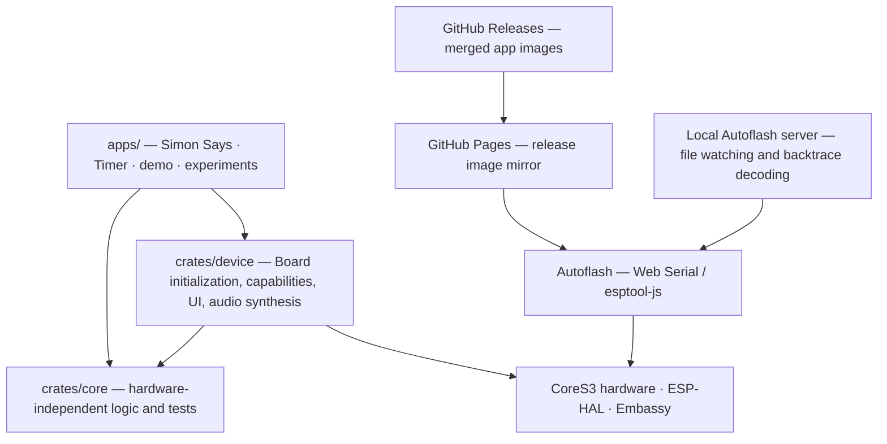

# CoreS3 Apps

Independent Rust firmware applications for the M5Stack CoreS3, with shared hardware services and a browser-based firmware manager.

| Application | Package / binary | What it does |
| --- | --- | --- |
| Simon Says | `simon_says` | Colour and sound memory game, solo or over ESP-NOW |
| Timer | `timer` | Countdown presets from 30 seconds to 25 minutes, touch and tilt controls, and a completion chime |
| Hardware demo | `demo` | Interactive screens for the board's capabilities |

Experimental firmware, including `imu_color`, `light_meter`, `color_ping`, `panic_backtrace`, and `template`, lives in the `cores3-experiments` package.

## Flash a release

Open [Autoflash](https://joshua-lehmann.github.io/cores3-apps/) in desktop Chrome/Edge or Android Chrome. Connect the CoreS3 over USB, authorize the device, load GitHub releases, select an application and version, and click **Download and flash release**. No local installation is required. Desktop uses Web Serial; Android Chrome uses WebUSB for compatible CDC serial devices. Both require HTTPS or localhost. Android USB-C flashing still needs physical-device validation; see the Autoflash guide. Firefox, Safari, and iOS are unsupported.

Autoflash flashes merged images at `0x0`, monitors serial output, and supports multiple authorized devices. A new release never triggers a flash by itself. See the [Autoflash guide](tools/autoflash/README.md) for local file watching, troubleshooting, and panic decoding.

## Timer controls

The lower-right battery indicator shows the AXP2101 fuel-gauge estimate rounded to 10% steps. It refreshes every ten seconds and turns red at 20% or below. `BAT --` means the battery is absent or its reading is unavailable; the estimate is not a precision measurement.

The timer starts in single-countdown mode. Tap the top-left **MODE** button to switch between **SINGLE** and **LOOP** while stopped. In loop mode, tap the top-right **EDIT** button to cycle between editing phase 1, phase 2, and ROUNDS. Use the bottom arrows or tilt to adjust the selection. The defaults are 30 seconds, 20 seconds, and five rounds. Each round contains both phases; the timer stops and displays COMPLETE after the final phase. The phase durations can be 20 or 30 seconds, 1, 2, 5, 10, or 25 minutes. Changing a phase or round count resets the loop to phase 1. Choose 1–99 rounds; the count is retained when you reset the timer or switch modes, and returns to five after power-off or reboot.

For tilt selection, hold the screen facing up, lower the **right edge** to advance, or the **left edge** to go back. Return the device to level between tilts and hold each tilt briefly. In single mode, the 25-minute Pomodoro preset is reached by stepping backward once from the initial 30-second preset, or forward five times. In loop mode, tilting adjusts the selected phase duration or round count. Tilts cannot change the selection while a timer is running.

Tap the instruction strip above the buttons to toggle IMU diagnostics. When enabled, roll, pitch, gravity direction, and gyroscope readings are logged once per second. In Autoflash, open the device log and use its download button to save it; diagnostics are off by default. Actual tilt response depends on the device and should be checked on hardware.

## Architecture



Each app has its own entry point and firmware binary. `Board::init()` provides handles to shared display, touch, IMU, audio, network, and other capabilities; application logic stays in its app. The hardware-independent `cores3-core` crate runs host tests. Autoflash is a separate tool, not firmware or a device-side launcher.

```text
apps/{simon_says,timer,demo}/  standalone firmware packages
apps/experiments/              experimental binaries
crates/device/                 board, capabilities, UI, synthesis
crates/core/                   shared hardware-independent logic
tools/autoflash/               browser UI and local server
.github/workflows/             CI, release images, GitHub Pages
```

## Build and flash locally

The [development container](.devcontainer/) supplies the ESP32-S3 Xtensa toolchain, Rust, and `cargo-espflash`. Otherwise install the matching toolchain and source the ESP environment; the version is specified in `Cargo.toml`.

From the repository root, build one application:

```bash
cargo build --release --package simon_says
cargo build --release --package timer
cargo build --release --package demo
```

For an experimental binary, use e.g. `cargo build --release --package cores3-experiments --bin imu_color`. `cargo build --release` builds the workspace's default application packages.

To generate a merged image for the local flash workflow:

```bash
cargo dist --package timer --bin timer
cd tools/autoflash && cargo run --release
```

Open <http://localhost:8080>, authorize the device, and select the repository's `firmware.bin`. Autoflash watches that file and reflashes connected devices after subsequent builds. Replace `timer` in both arguments to build another main app; experimental binaries use `--package cores3-experiments` with their own `--bin` name. Only merged images belong at `0x0`.

For a new app, create a package under `apps/`, add it to the workspace members in `Cargo.toml`, and use the `cores3-device` and `cores3-core` crates as needed. `apps/experiments/src/bin/template.rs` is a small starting point.

## Tests and releases

```bash
./scripts/test.sh                         # hardware-independent host tests
cargo fmt --check
cargo clippy --locked --release -- -D warnings
cargo build --locked --release
(cd tools/autoflash && npm ci && npm test && npm run build)
(cd tools/autoflash && cargo +stable test --locked)
```

The firmware commands use the ESP toolchain; `scripts/test.sh` selects the host toolchain. See [Fallow audit notes](docs/fallow-audit.md) for known findings.

After CI passes, a push to `main` that changes firmware source, shared crates, assets, or build configuration automatically publishes the next patch version (for example, `v0.2.3`). Documentation and Autoflash-only changes deploy the website without publishing firmware. Retrying a release reuses a stable tag already attached to its commit. Manual `v*` version tags remain supported. The release workflow builds merged `simon_says.bin`, `timer.bin`, and `demo.bin` assets. Autoflash discovers stable releases through the public GitHub API. GitHub Pages mirrors the release images for same-origin browser downloads because GitHub's asset download endpoint does not provide browser CORS access; a new release becomes flashable after the Pages deployment updates the mirror. The site publishes from the generated `gh-pages` branch; see [deployment and recovery details](tools/autoflash/README.md#pages-deployment-triggers).

For hardware and service details, see the crate documentation (`scripts/doc.sh`) and source modules. The [Autoflash server guide](tools/autoflash/SELF_HOSTING.md) covers configuration, network access, and ELF lookup.
